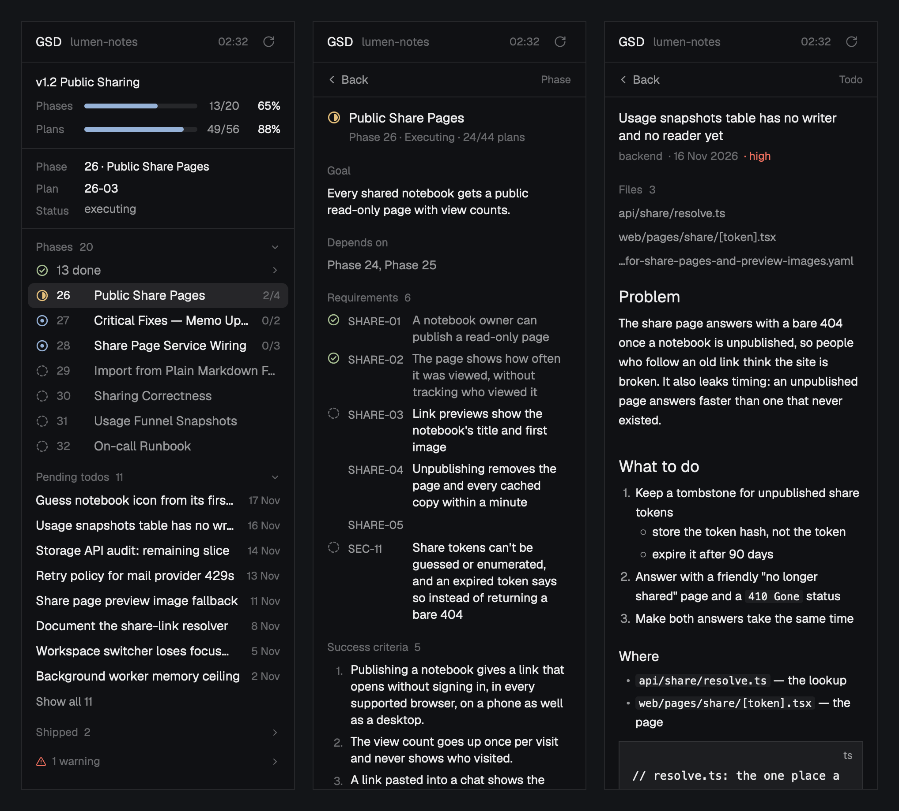

# GSD panel for Herdr

A read-only panel for the [Herdr](https://herdr.dev) desktop app. It shows the [GSD](https://github.com/gsd-build/get-shit-done) planning of the focused space: the milestone and its progress, where the work stands, the phases, the pending todos and the shipped milestones. A click on a phase or a todo opens its details.



The picture shows the panel three times with sample data: the list, a phase and a todo.

This is an independent project, not affiliated with Herdr or with get-shit-done. It only reads the `.planning` folder that GSD writes.

## What it does

- **Follows the focused space.** The project is found from the focused pane's folder, also inside a linked git worktree and on a space that runs on another machine.
- **Shows and hides itself.** The column appears on spaces whose folder has a `.planning` and hides on the others. Your own choice for a space wins and is remembered.
- **A button in the tab bar.** "GSD" with the milestone's progress in percent. A click shows or hides the column.
- **Stays current.** A local project is watched, so the panel updates a moment after GSD writes. A project on another machine is read every 30 seconds. Nothing is read while the column is hidden.
- **Details in place.** A phase shows its goal, dependencies, requirements, success criteria, plans by wave, verification and UAT. A todo shows its files and its notes as markdown.
- **Read-only.** It never writes to the project.

## What it runs

Herdr mods are trusted code that runs on your machine. This one:

- starts `sh` with a fixed script, once per load, on the machine of the space;
- in that script, runs `git` to find the project root (`rev-parse` and `worktree list`, both read-only);
- finds `node` and runs the project's own `gsd-tools.cjs` with it (`roadmap analyze`, `state-snapshot`, `list-todos`, and for a phase's details `roadmap get-phase`, `phase-plan-index`, `verification status`, `phase uat-passed`);
- starts your login shell once (`$SHELL -lc`, 5 seconds at most) to ask where `node` is, but only when `node` is in none of the usual places;
- reads files under `.planning/`.

It does not use the network and writes nothing in the project. Between runs it remembers two things: shown or hidden per space (Herdr's shared state, key `gsd.spaces`) and which sections are folded (the mod's local storage).

## Requirements

- The Herdr desktop app. Built and tested on 0.1.16 on macOS.
- On the machine of the space: a POSIX `sh`, `node`, and GSD (`gsd-core`; a legacy `get-shit-done` install works too, with a warning in the panel). Native Windows is not supported.

## Install

Ask the agent in a Herdr terminal to add the mod from this repository, or do it by hand:

```sh
git clone https://github.com/Maestro157/herdr-gsd
cp -R herdr-gsd/mods/gsd ~/.config/herdr-app/mods/gsd
herdr-app check ~/.config/herdr-app/mods/gsd
```

Copy the folder, do not link it: Herdr reloads a mod when a file in its real folder changes, not behind a symlink.

**As a window**, with no change to your layout:

```sh
herdr-app do mod.open --name gsd      # the same command closes it
```

**Docked**, as a column with its button in the tab bar. Shipped layouts never dock a mod, so this builds a personal layout `main-gsd` from the `main` layout your Herdr ships and switches to it:

```sh
node herdr-gsd/scripts/main-gsd-layout.mjs
herdr-app do layout.switch --name main-gsd
```

Run the script again after a Herdr update to rebuild the layout on the new `main`. It writes only `layouts/main-gsd.json` and keeps a replaced file beside it.

If you have your own layout, add these two blocks to it instead: the column next to your work area, the button in the row that holds your tabs.

```json
{ "id": "gsd", "type": "block", "size": { "px": 368 }, "min": 280, "max": 720,
  "content": { "mod": "gsd", "props": { "role": "column" } } }

{ "id": "gsd-button", "type": "block", "size": { "px": 92 }, "window_drag": true,
  "content": { "mod": "gsd", "props": { "role": "button" } } }
```

## Commands

For `keys.json`, or `herdr-app do gsd.<command>`:

| Command | What it does |
|---|---|
| `gsd.toggle` | shows or hides the column, like the button |
| `gsd.refresh` | reads the planning files again |
| `gsd.open-phase` | opens the current phase; `gsd.open-phase:26` opens phase 26 |
| `gsd.open-todo` | opens the first pending todo; `gsd.open-todo:3` the third, `gsd.open-todo:share` the first whose title or file contains "share" |
| `gsd.back` | returns from the details to the list |

## Development

```sh
node --test test/
```

needs Node 20 or newer and `git`; no Herdr. Two tests are skipped by design: one needs a machine without `node`, the other is an opt-in run over your own GSD projects (`GSD_SMOKE`, see `test/gsd/smoke.test.mjs`).

`RECIPE.md` is the brief another agent can rebuild the mod from. `mods/gsd/mock.js` holds sample projects for every state of the panel; `herdr-app check` draws them without running any program.

## Licence

MIT, see `LICENSE`. Some icons are from Lucide, see `NOTICE.md`.
