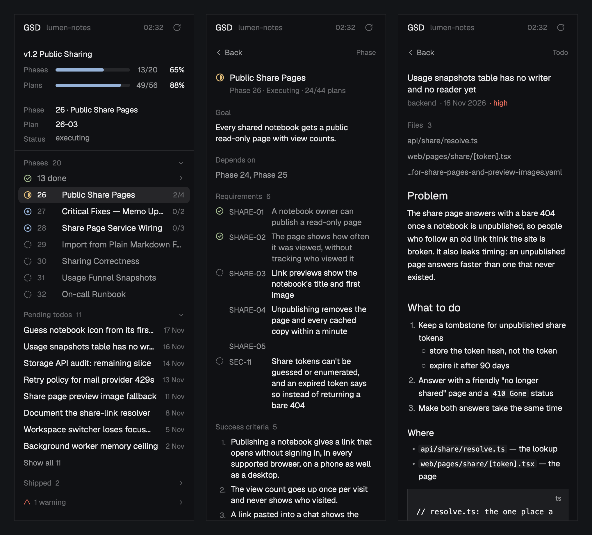

# GSD

A read-only panel that shows the GSD planning (`.planning/`) of the focused space: the milestone with two progress bars, the current phase, plan and status, the phases, the pending todos and the shipped milestones. A click on a phase or a todo opens its details in place. A button in the tab bar shows the milestone's progress and shows or hides the panel.

## What you see

Two pieces, both drawn by one mod (`mods/gsd/`), in theme colors only.

**The button**, in a block 92 px wide at the right of the tab bar:

- A pill 26 px high, radius 6, text 12 px: "GSD" and the phase progress in percent ("GSD 65%").
- Background `selected` while the column shows, `chrome` otherwise. Text `foreground` when on, `muted` when off, `dim` when the space has no planning.
- A red warning icon beside the figure when the last read failed.
- Tooltip: milestone, "phases 13/20", "plans 49/56".

**The column**, a block 368 px wide (280 to 720) after the Files/Changes panel, text 13 px, top to bottom:

1. **Header**, 42 px: "GSD" semibold, the project's name in `dim`, a small "worktree" badge when the planning comes from the main checkout of a linked worktree, "updated 02:32" (only the time when narrower than 330 px, "updating…" while reading) and a refresh icon that turns into a spinner.
2. **Milestone**: its label ("v1.2 Public Sharing"), then two bars, "Phases" and "Plans". Each has a label 42 px wide, a 5 px track in `border` with an `accent` fill, the count ("13/20") and the percent. An unknown value is a dashed outline with "n/a" or "–", never an empty bar.
3. **Position**: up to three lines, "Phase" (id · name), "Plan" and "Status" (two lines at most, the rest in a tooltip).
4. **The list**, scrolling, rows 26 px, section headers 30 px in `dim` with a count and a chevron:
   - **Phases**: finished ones fold into one row "13 done". Each phase row has a status icon, the id, the name and "2/4" (summaries of plans). The current phase has the `selected` background. Beyond 12 open phases the tail folds into "N more phases".
   - **Pending todos**: title, area (hidden when narrow) and date ("17 Nov"). 8 rows, then "Show all 11".
   - **Shipped**: version, name, date. Folded at first.
   - **Warnings**: what the reader could not make sense of. Folded at first, shown as "1 warning" in red.

Status icons, 13 px: done is a checked circle in `ansi2` (green), executing a half-filled circle in `working`, planned a dotted circle in `accent`, not started a dashed circle in `dim`.

**Details** replace the milestone, position and list. Below the header there is a 36 px row with "‹ Back" on the left and "Phase" or "Todo" on the right, then a scrolling page:

- **Phase**: status icon and name (13.5 px, medium), "Phase 26 · Executing · 24/44 plans", then the sections that exist: Goal, Depends on, Requirements (done mark, id, text), Success criteria (numbered), Plans (grouped by wave, with a done mark, id and title), Verification, UAT, warnings.
- **Todo**: title, a line "backend · 16 Nov 2026 · high" (the severity in red when high, critical, urgent or blocker), Files, the notes as selectable markdown, and the file's path.

**Other states** of the column: a spinner with "Reading .planning…"; a folder icon with "No GSD planning here" and the folder's path; a warning with the error and a "Retry" button; the last good data at half opacity while a folder seen before is read again; a strip "Refresh failed · reason · Retry" over the last good data when a later read fails.

## How it behaves

The mod shows planning files, not agents: agent status (working, blocked, done, idle) changes nothing in it.

- **Which project.** The focused pane's folder, else the focused terminal's, else the active space's folder, on that space's machine. From there the project root is the nearest folder with `.planning/` (the rule is under "Built from").
- **Show and hide by itself.** On a space switch, the first read of the folder decides: a `.planning` shows the column, none hides it.
- **The person's choice wins.** A click on the button, or any other show or hide of the column, is remembered for that space and overrides the automatic decision there from then on.
- **Staying current.** A shown column watches a local project's `.planning` folder and reads again 400 ms after the last change, 2.5 s after the first at the latest, and never more often than every 5 s. On top of that a watched project is read every 5 minutes, an unwatched local one every minute, and one on another machine every 30 s.
- **Hidden means idle.** A hidden column does not watch and does not read. It reads when it shows again.
- **Clicks.** The refresh icon reads again. A section header folds or opens its section (remembered). "13 done", "N more phases" and "Show all N" open and close their part (not remembered, reset per folder). A phase row, a todo row and the position's "Phase" line open details. "Back" returns to the list at the scroll position it had. "Retry" reads again.
- **Hovers.** Rows that open something get the `hover` background and a pointer. The bars' tooltip says "13 done, 9 verified, of 20" when GSD's own verified count is known.
- **Commands** (`herdr-app do gsd.<command>`, or keys): `refresh`, `toggle`, `open-phase[:<id>]`, `open-todo[:<n> | :<text>]`, `back`.
- **Details stay current.** When the project changes, an open phase or todo is read again, and closes if it is gone. A detail that loads within 300 ms never shows a spinner.

## Built from

**Layout.** Two blocks in a personal layout cloned from the shipped `main` (`scripts/main-gsd-layout.mjs` builds it as `main-gsd`):

- In the `work` column the `tabs` block becomes a row `tab-row` of the same height, not resizable: `tabs` (`weight: 1`, `window_drag`) and `gsd-button` (`{ "px": 92 }`, `window_drag`, `{ "mod": "gsd", "props": { "role": "button" } }`).
- In the `work-body` row, right after `panel`: `gsd` (`{ "px": 368 }`, `min` 280, `max` 720, `{ "mod": "gsd", "props": { "role": "column" } }`).

**One mod, four roles**, decided by where a copy sits: `button` and `column` from `props.role`; a window when opened with `mod.open` (`mod.json`: `"place": "none"`, overlay window 380 px wide, 85% high); a pane otherwise. A gsd block without props counts as the column. All copies share one module, so they share one read per folder, one cache and one show/hide decision maker.

**Files in `mods/gsd/`:**

- `main.js`: the view. Roles, the focused folder, shared loads, the folder watch, the timer, commands, clicks.
- `ui.js`: draws the button and the panel. The list is a virtual list of rows with known heights.
- `detail.js`: draws the phase and todo details.
- `data.js`: the data layer, with no imports. It gets `exec` and `readTextFile` passed in, so the tests run it under Node.
- `source.js`: the switch between sample data (`mock.js`) and `data.js`.
- `find.js`: finds a phase or todo for the commands. `visibility.js`: the show/hide rules, pure.
- `mock.js`: sample projects for every state. Twelve SVG icons.

**From `herdr`:** `spaces`, `panes`, `focused`, `layout`, `props`, `run` (`layout.show`, `layout.hide`), `theme`, `themes`, `checking`, `watchFolder`, `readTextFile`, `appHome`, `nextCommand`, `shared`, `setShared`, `exec`. **From `gpui-kit` and `gpui-base`:** `View`, `div`, `svg`, `h_flex`, `v_flex`, `v_virtual_list`, `VirtualListScrollHandle`, `Scrollbar`, `TextView.markdown`.

**Programs.** One `exec("sh", ["-c", SCRIPT, …])` per read, on the space's machine, with the folder and the driver source as arguments, never inside the script text. The script is POSIX sh and does three things:

1. **Finds the project root.** In a git checkout it walks up to the checkout's top. If nothing is there and the checkout is a linked worktree, it looks at the same folder in the main checkout. Failing that, it takes an ancestor whose `.planning/config.json` declares `sub_repos` or `multiRepo`. Outside git it walks up, stopping after the home folder. Git is called read-only (`rev-parse`, `worktree list`, `GIT_OPTIONAL_LOCKS=0`).
2. **Finds `node`**: on `PATH`, then the newest nvm version, then volta, mise, asdf, `~/.local/bin`, Homebrew and system paths, and last by asking the login shell (`$SHELL -lc`, 5 s at most).
3. **Finds `gsd-tools.cjs`**: in the project's `gsd-core`, `.claude/gsd-core`, `.codex/gsd-core`, then `${CLAUDE_CONFIG_DIR:-~/.claude}/gsd-core` and `${CODEX_HOME:-~/.codex}/gsd-core`. Legacy `get-shit-done` installs are used only when there is no `gsd-core` at all.

It then runs `node -e DRIVER`. The driver runs `gsd-tools roadmap analyze`, `state-snapshot` and `list-todos` in parallel, reads `STATE.md`, `MILESTONES.md` and `phases/` itself, trims everything to what the panel shows and prints one JSON object. A phase's details come from a second driver (`roadmap get-phase`, `phase-plan-index`, `verification status`, `phase uat-passed`, plus the plan files). A todo's details are one `readTextFile`. Nothing uses the network and nothing writes under `.planning/`.

**Art.** Seven icons from Lucide (`branch`, the three chevrons, `folder`, `refresh`, `warning`), four status circles and a spinner drawn for the mod, all `currentColor`.

## Watch out

- **A hidden block's copy never starts.** A mod copy starts the first time its block shows. A column hidden in the layout file would never decide to show itself, so the always-shown button feeds the shared show/hide rules too.
- **A hidden copy's timer runs, its `render` does not.** Everything that must notice a space switch is in the 1 s timer.
- **Our own show or hide lands late.** For up to 1.5 s after `layout.show` or `layout.hide`, the old state must not be read as the person's choice. The same holds right after the mod reloads.
- **`herdr-app check` must not run programs.** While `checking()` the mod draws sample data and starts nothing.
- **`gsd-tools planning inspect` is too slow** for this: megabytes of JSON and 10 to 33 s on a project with 135 phases, with no phase titles. `roadmap analyze` gives the panel's view in tens of kilobytes.
- **Keep git off the driver's `PATH`.** `roadmap analyze` spends most of its time in `git log` and `git diff` for advisory detail. The driver runs gsd-tools with a `PATH` that has no git, which gsd-tools treats as "git unavailable". On the largest project tried this took a read from 6.8 s to 0.7 s with the same output.
- **GSD's "complete" is stricter than "done".** It needs a passing, current verification file, so most finished phases only count as "executed". The panel counts a phase with every plan summarised as done and reports GSD's strict count as "verified" in the tooltip.
- **File content must never look like protocol.** Every line the script prints for the mod starts with `@@gsd:<nonce>`, a nonce per read. Paths are printed with `printf`, never `echo` (dash and macOS `sh` expand backslashes).
- **`STATE.md` is hand-edited** and often inconsistent. Values are shown as written, except that the current phase's name comes from the roadmap when the phase is listed.
- **Install by copy.** Herdr reloads a mod on a change in its real folder, not behind a symlink.
- **Shipped layouts never dock a mod.** Docking needs the personal layout, and the layout script must be run again after a Herdr update.
- **The markdown view has no minimum height.** In the detail page every part is `flex_none` inside a scrolling area, or the notes are cut off.
- **Limits:** a read may take 60 s (the driver gives up after 50 s, each gsd-tools call after 45 s); a todo's notes are cut at 20,000 characters; a phase shows 150 plans, then a count; 24 projects and 32 details are cached; the choice is remembered for 300 spaces.
- **Plain text only:** shipped milestones, plans, requirements and file paths open nothing.
- **Assumes** a POSIX `sh` on the space's machine (no native Windows), `node`, and a GSD install whose `gsd-tools` has the commands above. Built on Herdr 0.1.16 on macOS.

## Done when

- `node --test test/` passes: 117 tests, 2 skipped by design (one needs a machine without node, one is the opt-in run over real projects).
- `herdr-app check mods/gsd` passes and runs no program.
- On a space whose folder has a `.planning`, the column shows by itself with the milestone, both bars and the phases, and the button shows the same percent as the "Phases" bar.
- On a space without `.planning` the column hides by itself.
- Hiding the column with the button on a GSD space, switching to another space and back: it stays hidden. Showing it on a space without planning: it stays shown and says "No GSD planning here".
- Saving a change to `.planning/STATE.md` updates the panel within a few seconds, with no click.
- With the column hidden, no `sh` or `node` process of the mod starts (watch `ps`).
- A click on a phase shows its goal and plans; "Back" returns to the list at the same scroll position.
- In a linked git worktree without its own `.planning`, the panel shows the main checkout's planning and the "worktree" badge.
- A recursive listing of `.planning/` with sizes and modification times is identical before and after a read.
